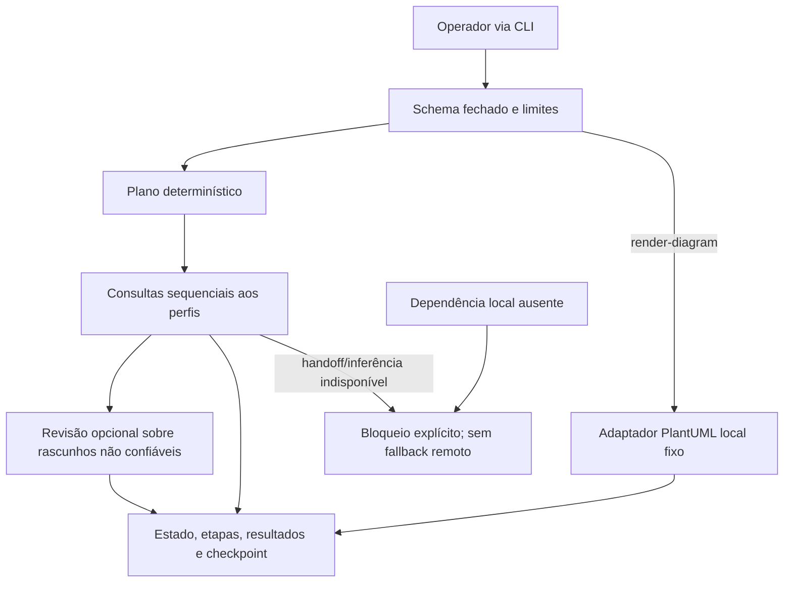

# Coordenação interna de tarefas

Esta implementação adiciona execução rastreável pela CLI para capacidades já existentes no SlothEngineer. O plano continua sendo uma proposta; `runTask` executa apenas consultas a especialistas pelo provedor local ou a renderização UML fixa. Não executa alterações de repositório, shell, peers, rede arbitrária, deploy ou ações externas.

## Caminho e responsabilidades



O chamador determina objetivo e, opcionalmente, até três perfis. O planejador escolhe perfis por palavras-chave se nenhum for informado. Workers e revisores são consultas individuais e sequenciais, não subagentes: o runtime não possui processos ou contextos isolados, então `subagents.count` e `depthUsed` permanecem zero. A revisão recebe rascunhos encapsulados como dados não confiáveis.

## Contrato

Entrada JSON aceita `objective`, `specialists`, `capability`, `includeReviewers`, `diagramSource`, `diagramFormat`, `limits` e um `resume` opcional. Campos desconhecidos são rejeitados. Tetos: 8 etapas, 60 segundos por tarefa, 2 tentativas e concorrência 1; profundidade de delegação é fixa em zero. Cancelamento usa `AbortSignal` e o provedor local propaga o sinal a chamadas loopback.

A saída inclui `taskId`, `status`, plano, etapas com modo (`deterministic`, `local_model`, `local_tool`, `simulated` ou `checkpoint_untrusted`), contagem de tentativas, resultados, dependências/entradas ausentes, limites, indicador `executed` e checkpoint em memória. O runtime não persiste entradas, prompts, saídas ou checkpoints. Checkpoints são dados do chamador e são marcados não confiáveis quando retomados; só podem ser reutilizados com a mesma definição da tarefa.

Estados distinguem conclusão, bloqueio, falha, parcial, cancelamento, timeout e necessidade de entrada. Um handoff não conta como geração. Erros só são repetidos quando marcados explicitamente como recuperáveis. Saídas de modelo e ferramentas permanecem não confiáveis e exigem revisão humana. Um checkpoint retomado pode concluir o fluxo sem executar uma nova chamada; nesse caso `executed` é falso.

## Uso e validação

```powershell
npm run run -- "Revisar o pipeline DevOps"
npm run run -- --json-base64 <JSON-em-UTF8-codificado-em-base64>
```

O primeiro formato usa a seleção heurística do plano. A forma codificada aceita o contrato JSON completo, incluindo seleção explícita de perfis, revisão e renderização UML.

O primeiro exemplo resulta em bloqueio explícito se o provedor estiver em `handoff` ou Ollama não estiver configurado. O segundo requer Java e o JAR local verificado; ausência retorna `blocked`. Não use resultados de fixtures como evidência de inferência real. A suite compara execução direta e composta com dependências simuladas e testa isolamento concorrente, limite/tentativas, falha fechada, cancelamento, retomada e ausência de ferramenta. Nenhuma melhoria de qualidade do modelo é inferida.

O MCP já existente não foi alterado nesta issue; a integração por `run_task` permanece futura e exige contrato/revisão próprios. Ver [requisitos](REQUIREMENTS.md), [arquitetura](ARCHITECTURE_PLAN.md), [especializações](specialists.md) e [rastreabilidade](TRACEABILITY.md).
